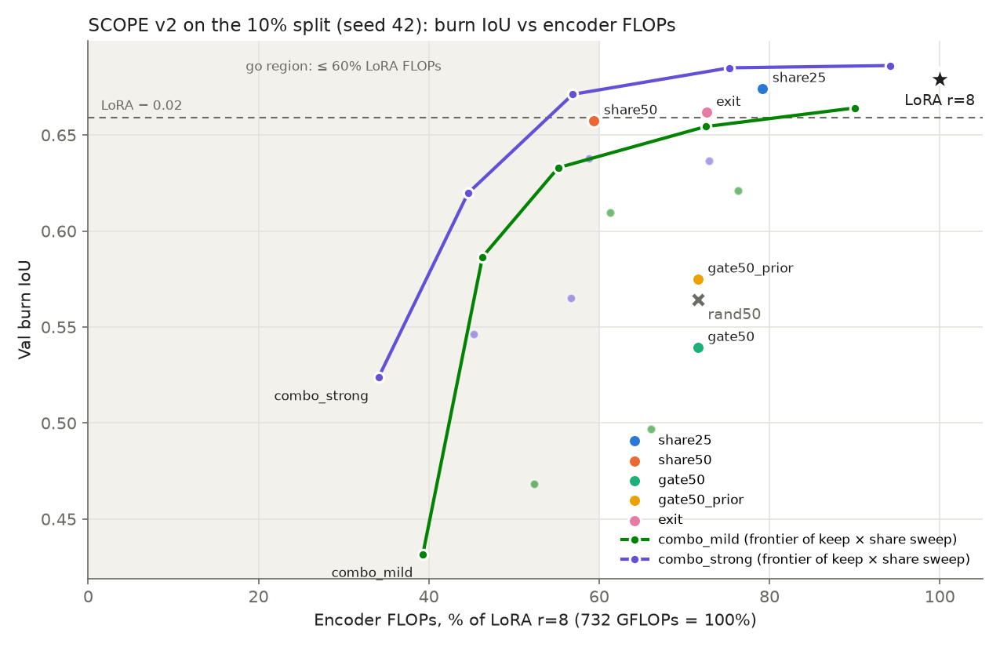

# SCOPE v2: diagnosis, fixes and a fair comparison (10% split, seed 42)

Follow-up to `results/scope_smoke/REPORT.md`. Everything here: branch `scope`, seed 42, `split_010pct` (54 training
scenes), 264 validation scenes, A100-80GB. One seed, so every comparison below is **promising**, not a result.
Details: `DIAGNOSIS.md`, `LOG.md`, `results_table.md`, `summary.json`, `eval/*.json`, `metrics/*.json`.
GPU use: about 1.7 GPU-hours (LoRA retrain 15 min, diagnostics 5 min, 8 Stage-B runs plus evaluation 80 min).

**FLOP convention.** Encoder forward GFLOPs, FLOPs = 2 × multiply-adds, one 512×512 image: all matmuls in the patch
embedding and the 24 blocks, including attention QKᵀ/AV, LoRA r=8, SCOPE gate projections and probes. The FCN head,
norms and softmax are not counted. Plain LoRA = **732.03 GFLOPs = 100%**. Measured (`torch.utils.flop_counter`) and
analytical counters agree to 0.00%. Token counts and FLOPs are averaged over all validation batches.

## 1. Diagnosis summary

- **Cause of keep 1.0 < keep 0.5: a train/eval mismatch in the v1 gate.** Training masks were hard 0/1 (no
  fractional values) but **stochastic**, at about 63% keep per block (logit + logistic noise > 0, with a random target
  rate). This is token-level stochastic depth without rescaling. At eval the gate took a deterministic top-k.
  Decoder-only IoU: keep 1.0 = 0.335, keep 0.5 = 0.554; re-using the stochastic train gate at eval = 0.599. Fixed with
  `gate_train_mode: topk_st` (same k tokens in training and eval). After the fix the keep curve is monotone
  (`combo_strong`, share 0: keep 1.0 = 0.686 > 0.75 = 0.637 > 0.5 = 0.565).
- **FLOPs:** v1's 722 = 2×MAC forward of the 24 blocks. The README's 637 = fvcore **MACs**, forward (317) plus an
  approximate backward, with the head included and SDPA attention not counted. Different units and scopes; neither
  input size nor encoder-vs-model alone explains it.
- **Training curves:** v1 early stopping was not premature (both runs plateau by epoch ~20, best epochs 28 and 24).
  v1's "254 s" was only the resumed segment of `s4_full` after a NaN crash at epoch 34. The v1 LoRA log and checkpoint
  were gone; LoRA was retrained (0.6792 vs v1's 0.6727).
- **Other v1 bugs:** v1 token counts and GFLOPs were taken from the last validation batch only. With exit on, a token
  exits only if it is confident in every image of the batch.
- **Probes vs decoder (v1):** probe-only IoU (0.47 / 0.38) was below decoder-only (0.55), and exit changed the
  combined result by < 0.001.

## 2. Results

All SCOPE-family runs share one recipe: warm start from the retrained LoRA r=8 checkpoint, Stage B (max 15 epochs,
`min_epochs` 8, patience 8 on val burn IoU, `lr_new` 2e-4, `lr_lora` 5e-5, cosine), frozen-teacher distillation (T=2,
weight 1), `topk_st` gate with fixed keep, `nbr_refine` off, probe loss 0.2. Only the listed knob changes. Exit
thresholds are calibrated per run on validation (lowest threshold with ≥ 98% probe pixel accuracy on the tokens it
would exit). The distillation teacher costs about 0.54 s per epoch (2–5% of an epoch, forward only).

**Headline rows** (each run at its own training setting, plus the go/no-go point):

| Run | Keep | Share | Exit | Burn IoU | Enc GFLOPs | % LoRA | Notes |
| --- | --- | --- | --- | --- | --- | --- | --- |
| `lora` | – | – | – | **0.6792** | 732.0 | 100.0 | retrained reference |
| `rand50` | 0.5 random | 0 | off | 0.5643 | 523.9 | 71.6 | fair random baseline |
| `share25` | – | 0.25 | off | 0.6742 | 579.8 | 79.2 | |
| `share50` | – | 0.5 | off | 0.6574 | 434.8 | 59.4 | gap to LoRA 0.022 |
| `gate50` | 0.5 | 0 | off | 0.5393 | 523.9 | 71.6 | below `rand50` |
| `gate50_prior` | 0.5 | 0 | off | 0.5750 | 523.9 | 71.6 | +0.036 over `gate50` |
| `exit` | – | 0 | on (66%) | 0.6618 | 531.2 | 72.6 | decoder-only 0.6880 |
| `combo_mild` | 0.75 | 0.25 | on (22%) | 0.6097 | 448.9 | 61.3 | best of sweep at ≤ 60%: 0.6330 @ 55.2% |
| `combo_strong` | 0.5 | 0.5 | on (32%) | 0.5238 | 249.8 | 34.1 | own setting |
| **`combo_strong`** | **1.0** | **0.5** | **on (8%)** | **0.6712** | **416.7** | **56.9** | **go/no-go point** |

Full table (one row per run and evaluation setting; decoder-only, probe-only and overwrite=decoder columns are filled
whenever exit is on; train time and VRAM are from training, VRAM includes the teacher):

| Run | Keep | Share | Own setting | Burn IoU | Dice | Mean IoU | Decoder-only IoU | Probe-8 / Probe-16 IoU | Overwrite=decoder IoU | Exited-patch acc | Enc GFLOPs | % LoRA | Attn / MLP tokens per block | Exit rate | Epochs run | Best epoch | Train time (s) | Peak VRAM (MB) |
|---|---|---|---|---|---|---|---|---|---|---|---|---|---|---|---|---|---|---|
| `lora` | 1.0 | 0.0 | yes | 0.6792 | 0.7948 | 0.8224 | – | – | – | – | 732.0 | 100.0 | 1025 / 1025 | 0.0% | 82 | 65 | 893 | 6029 |
| `rand50` | 0.5 | 0.0 | yes | 0.5643 | 0.6975 | 0.7604 | – | – | – | – | 523.9 | 71.6 | 1025 / 513 | 0.0% | 15 | 14 | 436 | 7346 |
| `share25` | 1.0 | 0.25 | yes | 0.6742 | 0.7908 | 0.8195 | – | – | – | – | 579.8 | 79.2 | 833 / 833 | 0.0% | 10 | 1 | 286 | 6691 |
| `share50` | 1.0 | 0.5 | yes | 0.6574 | 0.7762 | 0.8112 | – | – | – | – | 434.8 | 59.4 | 641 / 641 | 0.0% | 10 | 1 | 279 | 5997 |
| `gate50` | 0.5 | 0.0 | yes | 0.5393 | 0.6758 | 0.7461 | – | – | – | – | 523.9 | 71.6 | 1025 / 513 | 0.0% | 15 | 14 | 504 | 7731 |
| `gate50_prior` | 0.5 | 0.0 | yes | 0.5750 | 0.7079 | 0.7649 | – | – | – | – | 523.9 | 71.6 | 1025 / 513 | 0.0% | 15 | 14 | 504 | 7731 |
| `exit` | 1.0 | 0.0 | yes | 0.6618 | 0.7810 | 0.8128 | 0.6880 | 0.2942 / 0.5013 | 0.6365 | 0.9850 | 531.2 | 72.6 | 757 / 757 | 66.0% | 10 | 1 | 312 | 7361 |
| `combo_mild` | 0.75 | 0.25 | yes | 0.6097 | 0.7357 | 0.7842 | 0.6162 | 0.2849 / 0.4311 | 0.6105 | 0.9832 | 448.9 | 61.3 | 762 / 572 | 21.6% | 11 | 2 | 299 | 7019 |
| `combo_mild` | 1.0 | 0.0 |  | 0.6641 | 0.7805 | 0.8140 | 0.6703 | 0.2773 / 0.5368 | 0.6487 | 0.9892 | 659.1 | 90.0 | 931 / 931 | 23.2% | 11 | 2 | 299 | 7019 |
| `combo_mild` | 0.75 | 0.0 |  | 0.6209 | 0.7461 | 0.7902 | 0.6284 | 0.2867 / 0.4423 | 0.6197 | 0.9871 | 558.9 | 76.3 | 924 / 693 | 25.1% | 11 | 2 | 299 | 7019 |
| `combo_mild` | 0.5 | 0.0 |  | 0.4968 | 0.6363 | 0.7214 | 0.4989 | 0.1868 / 0.2844 | 0.5001 | 0.9678 | 483.8 | 66.1 | 956 / 479 | 17.8% | 11 | 2 | 299 | 7019 |
| `combo_mild` | 1.0 | 0.25 |  | 0.6544 | 0.7722 | 0.8084 | 0.6611 | 0.2831 / 0.5329 | 0.6449 | 0.9860 | 531.0 | 72.5 | 768 / 768 | 19.5% | 11 | 2 | 299 | 7019 |
| `combo_mild` | 0.5 | 0.25 |  | 0.4685 | 0.6084 | 0.7063 | 0.4737 | 0.1701 / 0.2616 | 0.4750 | 0.9581 | 383.7 | 52.4 | 784 / 393 | 15.5% | 11 | 2 | 299 | 7019 |
| `combo_mild` | 1.0 | 0.5 |  | 0.6330 | 0.7551 | 0.7968 | 0.6413 | 0.2849 / 0.5227 | 0.6214 | 0.9853 | 404.0 | 55.2 | 598 / 598 | 16.1% | 11 | 2 | 299 | 7019 |
| `combo_mild` | 0.75 | 0.5 |  | 0.5865 | 0.7170 | 0.7715 | 0.5947 | 0.2802 / 0.4207 | 0.5884 | 0.9816 | 338.8 | 46.3 | 591 / 444 | 19.4% | 11 | 2 | 299 | 7019 |
| `combo_mild` | 0.5 | 0.5 |  | 0.4317 | 0.5712 | 0.6869 | 0.4402 | 0.1594 / 0.2444 | 0.4387 | 0.9549 | 287.4 | 39.3 | 608 / 304 | 13.4% | 11 | 2 | 299 | 7019 |
| `combo_strong` | 0.5 | 0.5 | yes | 0.5238 | 0.6611 | 0.7363 | 0.5385 | 0.3514 / 0.3865 | 0.5340 | 0.9803 | 249.8 | 34.1 | 533 / 267 | 32.2% | 15 | 10 | 414 | 6251 |
| `combo_strong` | 1.0 | 0.0 |  | 0.6862 | 0.8006 | 0.8271 | 0.6915 | 0.2706 / 0.5291 | 0.6859 | 0.9936 | 689.5 | 94.2 | 970 / 970 | 11.9% | 15 | 10 | 414 | 6251 |
| `combo_strong` | 0.75 | 0.0 |  | 0.6365 | 0.7598 | 0.7995 | 0.6452 | 0.4224 / 0.5171 | 0.6346 | 0.9929 | 533.9 | 72.9 | 886 / 665 | 27.7% | 15 | 10 | 414 | 6251 |
| `combo_strong` | 0.5 | 0.0 |  | 0.5650 | 0.6993 | 0.7581 | 0.5744 | 0.3710 / 0.4209 | 0.5627 | 0.9868 | 415.2 | 56.7 | 833 / 417 | 37.0% | 15 | 10 | 414 | 6251 |
| `combo_strong` | 1.0 | 0.25 |  | 0.6850 | 0.8001 | 0.8263 | 0.6883 | 0.2684 / 0.5245 | 0.6861 | 0.9919 | 551.2 | 75.3 | 794 / 794 | 10.1% | 15 | 10 | 414 | 6251 |
| `combo_strong` | 0.75 | 0.25 |  | 0.6380 | 0.7624 | 0.8008 | 0.6468 | 0.4232 / 0.5231 | 0.6388 | 0.9898 | 430.6 | 58.8 | 733 / 550 | 24.5% | 15 | 10 | 414 | 6251 |
| `combo_strong` | 0.5 | 0.25 |  | 0.5463 | 0.6814 | 0.7483 | 0.5638 | 0.3612 / 0.4080 | 0.5534 | 0.9823 | 331.4 | 45.3 | 686 / 344 | 34.4% | 15 | 10 | 414 | 6251 |
| `combo_strong` | 1.0 | 0.5 |  | 0.6712 | 0.7890 | 0.8187 | 0.6741 | 0.2643 / 0.5197 | 0.6721 | 0.9905 | 416.7 | 56.9 | 616 / 616 | 8.3% | 15 | 10 | 414 | 6251 |
| `combo_strong` | 0.75 | 0.5 |  | 0.6197 | 0.7458 | 0.7907 | 0.6317 | 0.4195 / 0.5133 | 0.6215 | 0.9884 | 326.2 | 44.6 | 570 / 428 | 22.5% | 15 | 10 | 414 | 6251 |

Validation burn-IoU curves in Stage B (one value per epoch; the last value is the final re-validation of the best
checkpoint):

- `share25` / `share50` / `exit`: best at **epoch 1**, then flat or slightly lower (0.670 0.674 0.664 …; 0.656 0.657
  0.646 …; 0.626 0.667 0.649 …). Stage B on top of a converged LoRA mostly drifts; `min_epochs` 8 forced 10 epochs.
- `gate50` / `gate50_prior` / `rand50`: **still rising at epoch 14 of 15** (0.457 → 0.539; 0.511 → 0.575;
  0.506 → 0.564). The 15-epoch schedule caps the gated runs, so they may be under-trained.

### Plot

`iou_vs_flops.png`: burn IoU vs % of LoRA FLOPs. LoRA is the star and `rand50` the cross. Single-setting runs are
dots. For `combo_mild` and `combo_strong`, every keep × share point is a faint dot and the line is that run's Pareto
frontier. The shaded band is the go region (≤ 60% FLOPs); the dashed line is LoRA − 0.02.

## 3. Go / no-go and the 100%-label check

**Go (promising).** `combo_strong` at keep 1.0, share 0.5 (exit on, 8.3% exit rate) reaches **0.6712 burn IoU at
416.7 GFLOPs = 56.9% of LoRA**. That is **0.0080 below LoRA** (0.6792; the threshold is 0.02) and **0.1069 above
`rand50`** (0.5643 at 71.6%, a higher FLOP budget; the threshold is 0.03).

Read it with these caveats:

1. **The gate is fully open at the passing point (keep 1.0).** It is really "token sharing 0.5 + early exit" in a
   model trained with a keep-0.5 gate. At its own training setting (keep 0.5) `combo_strong` scores only 0.5238.
2. **The point was selected from a 9-setting sweep, and the exit thresholds were calibrated on the same validation
   set** it is scored on, so the gap is optimistic.
3. **Stage B by itself raises full-compute IoU** (`exit` decoder-only 0.6880; `combo_strong` keep 1.0 / share 0
   0.6862). Against that 0.686–0.688 reference the gap is 0.015–0.017: still inside 0.02, but with less margin.
4. **`share50` alone is close.** It misses by 0.0018 (gap 0.0218 at 59.4%), so most of the saving at the go point
   comes from Stage 1.

**100% labels: not run, waiting for a decision.** No plain LoRA r=8 `split_100pct` checkpoint exists (only its
metrics JSON in `results/metrics/`). The spec says to stop and ask before training a new 100% baseline.

## 4. One-sentence answers

- **Go or no-go?** Go (promising): `combo_strong` (keep 1.0, share 0.5, exit) gives 0.6712 at 56.9% of LoRA FLOPs,
  0.008 below LoRA (0.6792) and 0.107 above `rand50` (0.5643 at 71.6%). The point uses no gating and was chosen on the
  validation set.
- **Best single stage for IoU per FLOP saved?** Covariance token sharing (Stage 1). `share25` loses 0.00024 burn IoU
  per % of FLOPs saved and `share50` loses 0.00054. Early exit loses 0.00064, the learned gate 0.0037–0.0049, and the
  random gate 0.0041.
- **Does the spectral prior help?** Yes, on this seed: `gate50_prior` 0.5750 vs `gate50` 0.5393 (+0.036). Without
  the prior the learned gate is worse than random (0.5643); with it, it is only +0.011 better.
- **Decoder or probe path weaker with exit on?** As standalone predictors the probes are much weaker than the
  decoder (`exit`: probe-8 0.29, probe-16 0.50, decoder-only 0.688). For the tokens that do exit (98.5% pixel
  accuracy), the probe overwrite beats handing their mid-network features to the decoder (0.662 vs 0.637 for `exit`;
  within ±0.01 in the combos).
- **Gap to LoRA at 100% labels?** Not run: the 100% LoRA r=8 checkpoint does not exist, and training it needs your
  approval.

## 5. Deviations from the spec

1. **LoRA warm start retrained.** The v1 LoRA r=8 `split_010pct` checkpoint had been deleted. It was retrained once
   with the unchanged config (job 282246): 0.6792 val burn IoU, 82 epochs, best epoch 65. All v2 comparisons use it.
2. **`topk_st` / `fixed` are set in every v2 config, not as the model-class default.** The class keeps `gumbel` /
   `uniform` so the v1 configs (`configs/scope/*.yaml`) behave as before, per the "don't change existing configs"
   rule.
3. **KD direction.** The loss is the standard Hinton KD, KL(teacher ‖ student) =
   `F.kl_div(log_softmax(s/T), softmax(t/T))` × T², per pixel. The spec writes KL(student ‖ teacher); I read that as
   notation for standard KD. `feat_distill` is implemented but set to 0 (not used).
4. **`nbr_refine` off in all v2 runs**, so the ladder isolates the three stages and the SCOPE runs are not compared
   with LoRA using an extra refinement head (v1 gain: +0.012).
5. **Exit calibration.** Thresholds are symmetric per probe and calibrated at the run's own training setting with
   exit off, on per-image confidences. The v1 batch-coupled exit (a token exits only if it is confident in all 4
   images) is kept, and the measured accuracy on the tokens that actually exited is reported (95.5–99.4%). My first
   calibration rule ("monotone from the top") picked no threshold for `exit`. I switched to the spec's rule (lowest
   threshold reaching 98% on ≥ 100 tokens) and re-evaluated `exit` before the combos ran. During training,
   checkpoint selection for exit runs used the default 0.95 / 0.05 thresholds.
6. **Calibration and operating-point selection use the validation set** (as specified), which is also the reporting
   set; there is no separate test split here.
7. **Plot:** swept runs are drawn as Pareto frontiers plus faint points. Connecting a 2-D keep × share grid in FLOP
   order gave a meaningless zig-zag.
8. **LoRA row:** epochs and best epoch come from its CSV log (its metrics JSON was written by the pre-v2 `train.py`).
   The re-evaluation with the v2 evaluator reproduces Lightning's 0.6792 exactly.
9. The uncommitted edit in `results/scope_smoke/REPORT.md` that existed before this task was left untouched and not
   committed.
